# AI-Assisted Systematic Literature Review Framework

<p align="left">
  
  <a href="https://github.com/aprijunaidi/ai-assisted-slr-framework/stargazers"></a>
  <a href="https://github.com/aprijunaidi/ai-assisted-slr-framework/network/members"></a>
  <a href="https://github.com/aprijunaidi/ai-assisted-slr-framework/commits/main"></a>
  <a href="https://github.com/aprijunaidi/ai-assisted-slr-framework/actions/workflows/test-scripts.yml"></a>
</p>
<p align="left">
  <a href="https://www.prisma-statement.org/"></a>
  
  <a href="https://www.zotero.org/"></a>
  <a href="https://www.rayyan.ai/"></a>
  <a href="https://www.vosviewer.com/"></a>
  <a href="LICENSE"></a>
  <a href="LICENSE-docs.md"></a>
  <a href="#how-to-cite"></a>
</p>

A step-by-step, reproducible workflow for writing a **systematic literature review (SLR)** with the help of AI tools, from the first idea to the submitted manuscript. It is written for postgraduate students and researchers, and illustrated with a worked example on **deep learning for rice leaf disease detection**.

The framework follows the PRISMA 2020 statement and combines it with practical tooling: AI assistants for ideation, Zotero and Rayyan for screening, a computer-vision-specific quality checklist, and small Python scripts that make the counts and figures reproducible.



<sub>Animated diagram: each block lights up in the order of the workflow. Static versions for papers and slides: [PNG](figures/slr-framework.png) · [PDF](figures/slr-framework.pdf) · [SVG](figures/slr-framework.svg).</sub>

## The workflow at a glance

| Stage | What you do | Main tools | Guide |
|---|---|---|---|
| **1 · Ideation** | Map existing reviews, choose an angle, write the research objective and research questions | scite, NotebookLM, Humata, Claude, DeepSeek, Qwen | [01 Ideation and prompting](docs/01-ideation-and-prompting.md) · [02 RO and RQs](docs/02-research-objective-and-questions.md) |
| **2 · Search** | Turn the RQs into concept blocks and database-specific strings; log every search | Web of Science, Scopus, IEEE Xplore, ScienceDirect, ACM DL | [03 Search strategy](docs/03-search-strategy.md) |
| **3 · Selection** | De-duplicate, screen titles/abstracts and full texts, apply eligibility criteria, assess quality | Zotero, Rayyan, `dedup_ris.py`, `qa_score.py` | [04 Screening](docs/04-reference-management-and-screening.md) · [05 Inclusion/exclusion](docs/05-inclusion-exclusion-criteria.md) · [06 Quality assessment](docs/06-quality-assessment.md) |
| **4 · Extraction and analysis** | Extract data per RQ, describe the literature, synthesise, draw the PRISMA flow | Extraction template, VOSviewer, Python, Napkin | [07 Extraction and bibliometrics](docs/07-data-extraction-and-bibliometrics.md) |
| **5 · Writing** | Write by RQ, cite from Zotero, refine language, disclose AI use, publish the reproducibility package | Zotero, InstaText | [08 Writing and reporting](docs/08-writing-and-reporting.md) |

The decision logic of stages 2–4 (criteria first, then quality threshold, then extraction):


## Worked example in one table

| No. | Research question | Motivation |
|---|---|---|
| RQ1 | Which image datasets and acquisition conditions are used to train and test rice leaf disease detectors, and how available and well documented are they? | Models trained on clean laboratory images often fail in the field; the data behind the evidence decides how far results transfer and whether they can be reproduced. |
| RQ2 | Which deep learning architectures and feature-enhancement strategies are used to detect small, irregular and overlapping lesions, and how do they compare on the reported metrics? | Early lesions are small and look like healthy tissue; comparing design choices and their cost guides model selection. |
| RQ3 | How rigorously are these models evaluated and deployed (metric definitions, splits, repeated runs, statistics, cross-dataset tests, speed on edge hardware)? | Small reported gains may fall within run-to-run variation, and workstation speed says little about field devices. |

Full objective and concept blocks: [docs/02](docs/02-research-objective-and-questions.md).

## Repository structure

```text
ai-assisted-slr-framework/
├── docs/                 Step-by-step guides (stages 1–5)
├── figures/              Framework and process diagrams (PNG, PDF, editable SVG)
├── templates/            CSV templates: search log, screening log, eligibility,
│                         quality assessment, data extraction, PRISMA counts
├── scripts/              Python helpers (standard library + matplotlib)
│   ├── dedup_ris.py        merge RIS exports and remove duplicates (DOI, title+year)
│   ├── qa_score.py         quality scores, threshold decisions, Cohen's kappa
│   ├── prisma_flow.py      PRISMA 2020-style flow diagram from counts, with consistency check
│   └── bibliometrics.py    publications per year, top venues, top keywords
└── tests/                Synthetic fixtures and a script that runs every tool
```

## Quick start

```bash
git clone https://github.com/aprijunaidi/ai-assisted-slr-framework.git
cd ai-assisted-slr-framework
pip install -r scripts/requirements.txt
bash tests/run_tests.sh          # checks that all scripts run on the synthetic fixtures
```

Then, for your own review:

1. Copy `templates/` into your project folder.
2. Work through `docs/01` → `docs/08`, filling in the templates as you go.
3. Run the scripts on your own files:

```bash
python scripts/dedup_ris.py exports/*.ris --out merged.ris --log dedup_log.csv
python scripts/qa_score.py templates/quality_assessment.csv --threshold 50 --mandatory QA1 QA6
python scripts/prisma_flow.py templates/prisma_counts.csv --out figures/prisma_flow.png
python scripts/bibliometrics.py included.ris --out results/
```

## Principles

- **AI proposes, databases confirm.** Generative tools help with wording, terms and structure. Papers, numbers and claims enter the review only after they are found and checked in the databases.
- **Decide before you look.** RQs, strings, criteria and the quality threshold are fixed in a protocol before screening starts, ideally registered (for example on [OSF](https://osf.io)).
- **Log everything.** Search dates, strings, hit counts, screening decisions and QA scores are recorded in the templates so another researcher can repeat the review.
- **Disclose AI use** in the form the target journal requires (see [docs/08](docs/08-writing-and-reporting.md)).

## Key references

- M. J. Page *et al.*, "The PRISMA 2020 statement: an updated guideline for reporting systematic reviews," *BMJ*, vol. 372, n71, 2021, doi: [10.1136/bmj.n71](https://doi.org/10.1136/bmj.n71).
- C. Wohlin, "Guidelines for snowballing in systematic literature studies and a replication in software engineering," in *Proc. EASE*, 2014, doi: [10.1145/2601248.2601268](https://doi.org/10.1145/2601248.2601268).

## How to cite

If this framework helps your review, please cite it. Pick the style you need and use the copy button at the top right of the box.

**APA (7th edition)**

```text
Junaidi, A. (2026). AI-assisted systematic literature review framework (Version 1.0.0) [Computer software]. GitHub. https://github.com/aprijunaidi/ai-assisted-slr-framework
```

**IEEE**

```text
A. Junaidi, "AI-assisted systematic literature review framework," version 1.0.0, GitHub, 2026. [Online]. Available: https://github.com/aprijunaidi/ai-assisted-slr-framework
```

**Harvard**

```text
Junaidi, A. (2026) AI-assisted systematic literature review framework, version 1.0.0. GitHub. Available at: https://github.com/aprijunaidi/ai-assisted-slr-framework (Accessed: [date]).
```

**BibTeX** (LaTeX, Overleaf, Zotero, Mendeley)

```bibtex
@software{junaidi2026slrframework,
  author  = {Junaidi, Apri},
  title   = {{AI-Assisted Systematic Literature Review Framework}},
  year    = {2026},
  version = {1.0.0},
  url     = {https://github.com/aprijunaidi/ai-assisted-slr-framework},
  note    = {GitHub repository}
}
```

**RIS** (import into Zotero, Mendeley or EndNote)

```text
TY  - COMP
AU  - Junaidi, Apri
TI  - AI-Assisted Systematic Literature Review Framework
PY  - 2026
ET  - 1.0.0
PB  - GitHub
UR  - https://github.com/aprijunaidi/ai-assisted-slr-framework
ER  - 
```

You can also use the **"Cite this repository"** button in the right sidebar, which reads [`CITATION.cff`](CITATION.cff).

## Licence

Code (`scripts/`, `tests/`): [MIT](LICENSE). Documentation, figures and templates: [CC BY 4.0](LICENSE-docs.md).

## Ringkasan (Bahasa Indonesia)

Repositori ini berisi kerangka kerja SLR berbantuan AI yang dapat ditiru langkah demi langkah: (1) ideasi dan *prompting* untuk merumuskan tujuan dan pertanyaan penelitian, (2) penyusunan *search string* untuk Web of Science, Scopus, IEEE Xplore, ScienceDirect dan ACM, (3) seleksi artikel dengan Zotero dan Rayyan, kriteria inklusi/eksklusi dan *quality assessment*, (4) ekstraksi data, bibliometrik dan diagram PRISMA, serta (5) penulisan artikel. Contoh kasus yang digunakan adalah deteksi penyakit daun padi berbasis *deep learning*.

---
Maintained by **Apri Junaidi**, Faculty of Computing, Universiti Teknologi Malaysia.
