# Stage 1 · Ideation, brainstorming and prompting

**Goal of this stage:** leave with a review topic, one research objective (RO), a small set of research questions (RQs) with their motivations, and concept blocks with a first list of search terms. Nothing found by an AI tool at this stage is evidence yet; it is a lead to be checked in Stage 2.



## 1.1 Which tool for which job

The tools are interchangeable to a degree, but each has a strength. Use at least one *grounded* tool (one that answers from real papers) next to one *generative* tool (one that helps you think and write).

| Tool | Type | Best use in an SLR | Watch out for |
|---|---|---|---|
| [scite](https://scite.ai) | Grounded (citation database) | Check whether a claim is supported or contrasted by published papers; find recent reviews on the topic | Coverage gaps; read the paper, not only the citation statement |
| [NotebookLM](https://notebooklm.google.com) | Grounded (your uploaded PDFs) | Ask questions across 10–50 key papers; compare how papers define the problem | Only knows what you upload |
| [Humata](https://www.humata.ai) | Grounded (your uploaded PDFs) | Summarise and interrogate long PDFs, extract methods and datasets | Same as above; check page references |
| [Claude](https://claude.ai) | Generative | Structure the RO, RQs, concept blocks and Boolean search strings; critique and tighten wording | Never cite a paper it names without checking the DOI |
| [DeepSeek](https://www.deepseek.com) | Generative | Alternative brainstorming, synonym generation, second opinion on the RQs | Same as above |
| [Qwen](https://chat.qwen.ai) | Generative | Alternative brainstorming; useful for multilingual terms | Same as above |

**Golden rule:** a generative model can propose terms, angles and wording. It cannot provide evidence. Any paper, number or claim it mentions enters the review only if it is found again through a database search in Stage 2.

## 1.2 Prompt workflow

Run the prompts in order. Paste the output of each step into the next one. The prompts are written for *rice leaf disease detection*; replace the bracketed parts for another topic.

### Prompt 1 · Map the field (grounded tool: scite or NotebookLM)

```text
I am planning a systematic literature review on [deep learning for rice leaf disease
detection]. Using only peer-reviewed sources from [2021–2025]:
1. List existing review or survey articles on this topic, with authors, year, venue and DOI.
2. For each review, state its scope (crops, diseases, model families, years covered)
   and the main open problems it reports.
3. Identify what these reviews do NOT cover (for example: field images, small lesions,
   evaluation rigour, edge deployment, specific diseases or regions).
Answer in a table. If you are not sure a source exists, say so instead of guessing.
```

*Why:* a new SLR must justify itself against existing reviews. Save every DOI and check it on the publisher page.

### Prompt 2 · Brainstorm angles (generative tool: Claude, DeepSeek or Qwen)

```text
Context: [paste the table from Prompt 1].
Act as a senior researcher in precision agriculture and computer vision. Suggest
6 possible angles for a NEW systematic review on rice leaf disease detection that
would not duplicate the reviews above. For each angle give: (a) a one-line focus,
(b) why it matters to farmers or practitioners, (c) why it matters to researchers,
(d) a rough sense of whether enough primary studies are likely to exist.
Do not cite papers; I will verify the literature myself.
```

### Prompt 3 · Write the research objective (Claude)

```text
I have chosen this angle: [paste the chosen angle].
Write ONE research objective for a systematic literature review in formal academic
English. It must state: the action (identify / appraise / synthesise), the evidence
base (peer-reviewed studies, years), the population (crop and diseases), the concept
(the methods of interest) and the outcomes (what will be compared). Maximum 60 words.
Then give two shorter alternatives and explain the trade-off between the three.
```

### Prompt 4 · Derive research questions and motivations (Claude)

```text
Research objective: [paste the RO].
Derive exactly 3 research questions that together cover the objective without
overlapping. For each RQ:
- make it answerable from data that published papers actually report;
- avoid yes/no questions;
- give a motivation (2 sentences): the practical problem and the research gap.
Return a Markdown table with columns: No. | Research question | Motivation.
Then list, for each RQ, the data items I must extract from every paper to answer it.
```

### Prompt 5 · Derive the search concepts from the RQs (Claude)

```text
For the RO and RQs below, identify the key concepts that every relevant paper
must mention, and split them into 3–4 concept blocks for database searching
(for example crop, disease, method, deployment). For each block list synonyms, spelling variants (British/US),
abbreviations and specific sub-terms (for example disease names). Mark which terms
need truncation (*) and which must stay as exact phrases.
RO: [...]
RQs: [...]
```

### Prompt 6 · Stress-test the RQs (a second generative tool: DeepSeek or Qwen)

```text
Act as a critical reviewer for a Q1 journal. Here are the RO and RQs of a planned
systematic review: [...]. Identify (1) RQs that are too broad or too narrow,
(2) RQs that published papers cannot answer because the data is rarely reported,
(3) overlaps between RQs, (4) terms that are ambiguous. Suggest concrete rewrites.
```

Using a different model for the critique avoids a model grading its own suggestions.

### Prompt 7 · Test against the literature (grounded tool: NotebookLM or Humata)

Upload 10–20 recent primary studies that you already know are relevant, then ask:

```text
For each uploaded paper, state whether it reports the information needed for each
research question below. Answer "reported", "partly" or "not reported" with the page
number. RQ1: [...] RQ2: [...] RQ3: [...]
```

If most papers do not report what an RQ needs, rewrite that RQ now. This is the cheapest moment to change it.

## 1.3 Output of Stage 1 (checklist)

- [ ] One research objective (≤ 60 words)
- [ ] Three RQs with motivations, in a table ([example](02-research-objective-and-questions.md))
- [ ] Concept blocks with synonyms, derived from the RQs
- [ ] List of existing reviews with verified DOIs, and one paragraph on what the new review adds
- [ ] A log of the prompts used and the tools/versions (needed for the AI-use statement, see [Stage 5](08-writing-and-reporting.md))
