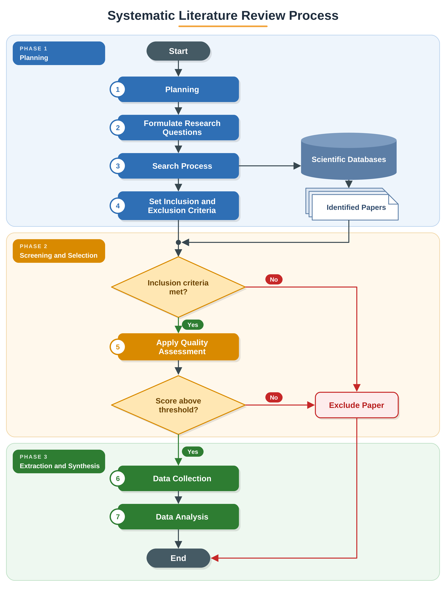

# Stage 3c · Quality assessment (QA)

**Goal:** judge how much each included study can be trusted and how useful it is for the RQs, using the same written checklist for every paper, so that the synthesis rests on studies that report enough to be believed and reused.



## 6.1 Why a computer-vision-specific checklist

Clinical tools such as RoB 2 or ROBINS-I were designed for trials and observational health studies and do not fit papers that train and test detectors. For deep learning studies, the main threats to trustworthy results are different: undocumented or unavailable datasets, leakage between training and test images, weak or untuned baselines, ambiguous metrics, single training runs reported as definitive, and speed claims measured on the wrong hardware. The checklist below targets these threats and links each item to an RQ.

## 6.2 Checklist

Each item is scored **1 (High)**, **0.5 (Medium)**, **0 (Low)**, or **NA** when the item does not apply.

| Item | Question | RQ | High (1) | Medium (0.5) | Low (0) |
|---|---|---|---|---|---|
| **QA1** | Is the research problem on rice leaf disease detection clearly stated and the contribution defined? | All | Problem, target diseases and contribution stated explicitly | Problem stated, contribution vague | Rice disease is incidental to the paper |
| **QA2** | Is the dataset described (source, number of images, classes, annotation, acquisition conditions)? | RQ1 | All five described | Some described | Hardly described |
| **QA3** | Are the train/validation/test splits described and is leakage between them prevented? | RQ1, RQ3 | Split ratios and procedure given; split done before augmentation; no near-duplicate images across splits | Ratios given, procedure unclear | Not described, or augmentation/tiling before splitting |
| **QA4** | Is the model described in enough detail to reimplement (architecture, modules, input size, training settings)? | RQ2 | Architecture, input size, optimiser, epochs, batch size and key hyperparameters given | Architecture given, training settings partial | Model named only |
| **QA5** | Is the model compared with appropriate baselines trained on the same data and settings? | RQ2 | Recent baselines, same data and settings | Baselines present but older or settings differ | No baselines, or numbers copied from other papers on other data |
| **QA6** | Are the metrics defined and reported on a held-out test set? | RQ2, RQ3 | Metric definitions given (e.g. mAP@0.5 vs mAP@0.5:0.95, IoU threshold); test set separate from model selection | Metrics named but not defined, or test/validation unclear | Only training or validation results |
| **QA7** | Is variability or generalisation assessed (repeated runs or seeds with SD/CI or a statistical test; cross-dataset or field testing)? | RQ3 | At least one of: ≥ 3 runs with spread, statistical test, external/field test set | Ablation only, or a single extra test set without discussion | Single run, single in-domain test set |
| **QA8** | If real-time or edge deployment is claimed, is it supported by measurements on the stated hardware? | RQ3 | Device named; latency/FPS, input size and precision (FP32/FP16/INT8) measured on that device | Speed reported on a workstation GPU only, or device named without full measurement details | Claim made with no measurement · **NA** if no deployment claim |
| **QA9** | Are data and code available, and are limitations discussed? | All | Public data and code links, limitations discussed | One of the two available, or limitations brief | Neither available, no limitations |

## 6.3 Scoring and threshold

```text
score       = sum of item scores (NA items left out)
max_score   = number of applicable items
quality (%) = 100 × score / max_score
```

**Decision rule used in the worked example**

- **Include** if quality ≥ **50%** **and** QA1 ≥ 0.5 **and** QA6 ≥ 0.5.
- Otherwise **exclude** at the QA stage and record the reason.

The two mandatory items protect the synthesis: without a clear rice-disease problem (QA1) or test-set results with defined metrics (QA6), nothing from the paper can be compared. The 50% cut-off is a judgement, so state it in the protocol before scoring and report a **sensitivity check**: do the main conclusions change if the threshold is 40% or 60%?

Scores are also used beyond the cut-off:
- tag each included study as *high* (≥ 75%), *moderate* (50–74%) in the extraction table;
- when studies disagree in the synthesis, give more weight to the higher-quality ones, and say so;
- report the item-level results as a table or stacked bar chart; low scores on QA3, QA7 or QA8 across many papers are themselves a finding for RQ3.

## 6.4 Procedure

1. **Calibrate:** two reviewers score the same 5 papers independently, compare, and agree on how the anchors are read. Update the anchor wording if needed.
2. **Score** all papers in [`templates/quality_assessment.csv`](../templates/quality_assessment.csv): one row per paper per reviewer, with the page or section that supports each score in the `evidence` column.
3. **Compute** scores, decisions and agreement:
   ```bash
   python scripts/qa_score.py templates/quality_assessment.csv --threshold 50 --mandatory QA1 QA6
   ```
4. **Resolve** disagreements by discussion; record the consensus row with `reviewer = consensus`.
5. **Report:** the checklist, the scoring rule, the threshold and its justification, the number of papers excluded at the QA stage, the agreement, and the sensitivity check.
